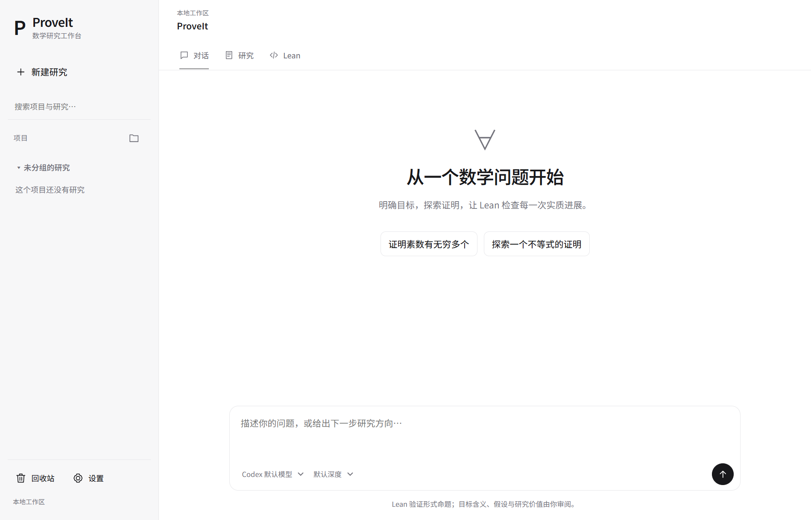

# ProveIt

**An AI-assisted mathematical research workspace connecting Codex and Lean 4.**

[Download](https://github.com/honghongzhong/Prove-It/releases/latest) · [Installation](docs/INSTALL.md) · [User guide](docs/USAGE.md) · [Build from source](docs/DEVELOPMENT.md) · [简体中文](README.zh-CN.md)

ProveIt brings Codex's reasoning and coding capabilities into a human-guided mathematical workflow. Researchers pose questions, clarify assumptions and choose directions. The AI maintains structured goals, proof steps, natural-language arguments and Lean code, then iterates on actual verification feedback.



## Download and run

For **Windows x64**, download `ProveIt-*-windows-x64-setup.exe` from [Releases](https://github.com/honghongzhong/Prove-It/releases). A ZIP distribution is also available: extract the entire archive and run `ProveIt.exe`. Do not move the executable out of its accompanying files.

The desktop package includes Electron and the Python backend. **You do not need to install Python.** Install these tools separately:

- **Lean 4 / Elan**, available to native Windows processes.
- **Codex CLI**, authenticated with your own account.
- Optionally, a prepared **Mathlib / Lake project** for library-dependent research.

See the [installation guide](docs/INSTALL.md) for setup, custom executable paths and troubleshooting. This release provides Windows x64 packages; macOS and Linux desktop installers are not included.

The release is **unsigned**, so Windows may display an unknown-publisher prompt. Obtain files from this repository's release page and compare their hashes with `SHA256SUMS.txt`. Do not disable operating-system security protections. ProveIt is not an official OpenAI or Lean product.

## Workspace

- **Project sidebar:** create, rename, search and organize research conversations; restore deleted research from Trash.
- **Conversation:** choose a model and reasoning effort, follow streamed responses and interleaved tool calls, give new directions, pause or continue.
- **Research:** manage the natural-language goal, assumptions, complete formal target, proof outline and written argument. Human review is recorded separately.
- **Lean:** edit source, select the verification environment and inspect real diagnostics and evidence tied to the current artifacts.
- **Export:** save Lean source, a readable Markdown report or a JSON record containing revision history.
- **Appearance:** English and Chinese interfaces, light and dark themes, locally hosted fonts and KaTeX math rendering.

## Research workflow

1. Describe the mathematical question and any constraints or preferred methods.
2. Review the AI's proposed statement, quantifiers and assumptions before approving its interpretation.
3. Break the argument into steps and refine the natural-language proof alongside Lean code.
4. Run Lean, inspect actual diagnostics and iterate on saved candidates.
5. Give further direction whenever needed. The AI cannot approve human review on your behalf.
6. Export the work, including unresolved steps and the current verification status.

For a first check, ask ProveIt to prove that every natural number satisfies `n + 0 = n` using core Lean. The [user guide](docs/USAGE.md) also provides a complete manual test target and explains backup and recovery.

## Run from source

The Python backend uses only the standard library and requires Python 3.11+:

```powershell
git clone https://github.com/honghongzhong/Prove-It.git
cd Prove-It
lean --version
codex --version
codex login
python app.py
```

Open http://127.0.0.1:8765. For desktop development and installer builds, see [DEVELOPMENT.md](docs/DEVELOPMENT.md).

## What verification means

A target is marked verified only after Lean actually accepts the complete registered proposition and its axiom audit passes. Compiling a candidate, proving a helper lemma or checking finite examples does **not** establish the full research target.

The audit rejects `sorryAx` and additional axioms. The accepted standard foundational axioms are `propext`, `Classical.choice` and `Quot.sound`. Changing the source, target or selected environment invalidates older evidence.

**Lean checks the encoded proposition. It does not establish the fidelity of a natural-language translation, the suitability of assumptions, novelty or mathematical significance.** These remain human review tasks. ProveIt does not guarantee that AI can solve a proposed problem.

## Data and privacy

Desktop research is stored in `%APPDATA%/ProveIt/workspace`, separately from application files. Source mode stores it locally under `proofs/` and `.proveit/` by default. Quit the app before backing up the entire workspace; see the user guide for migration instructions.

The repository and installers contain no author's research, conversations, account credentials, databases, logs or local Lean/Mathlib workspaces. Git ignore rules, explicit packaging resource lists and release checks restrict what is published.

Codex receives the research and context you submit under your own account, provider and configuration. ProveIt adds no telemetry and does not collect login passwords. Lean metaprograms, Lake projects and Codex tools can execute local code: this is a **trusted local research environment**, not a sandbox for untrusted code. Do not publicly forward the backend port.

## Contributing and license

[Issues](https://github.com/honghongzhong/Prove-It/issues) and focused contributions are welcome. Remove private research, tokens and local paths from reports. See [CONTRIBUTING.md](CONTRIBUTING.md) and [SECURITY.md](SECURITY.md).

Released under the repository's existing [MIT License](LICENSE). Third-party license information is retained in [THIRD_PARTY_NOTICES.md](THIRD_PARTY_NOTICES.md) and the distributed dependencies.
